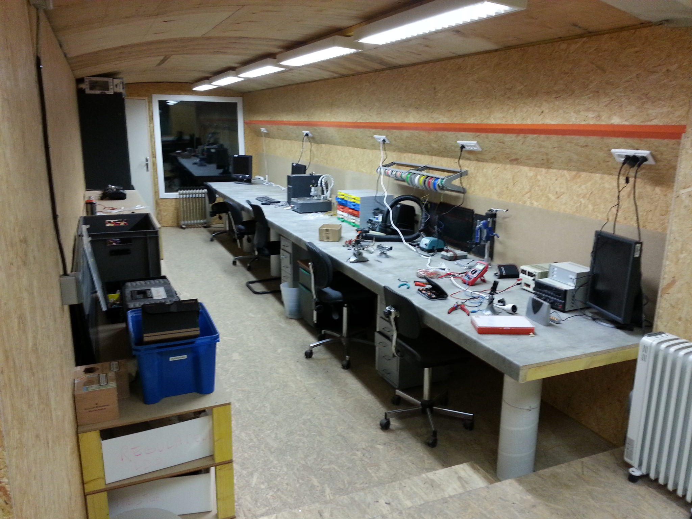
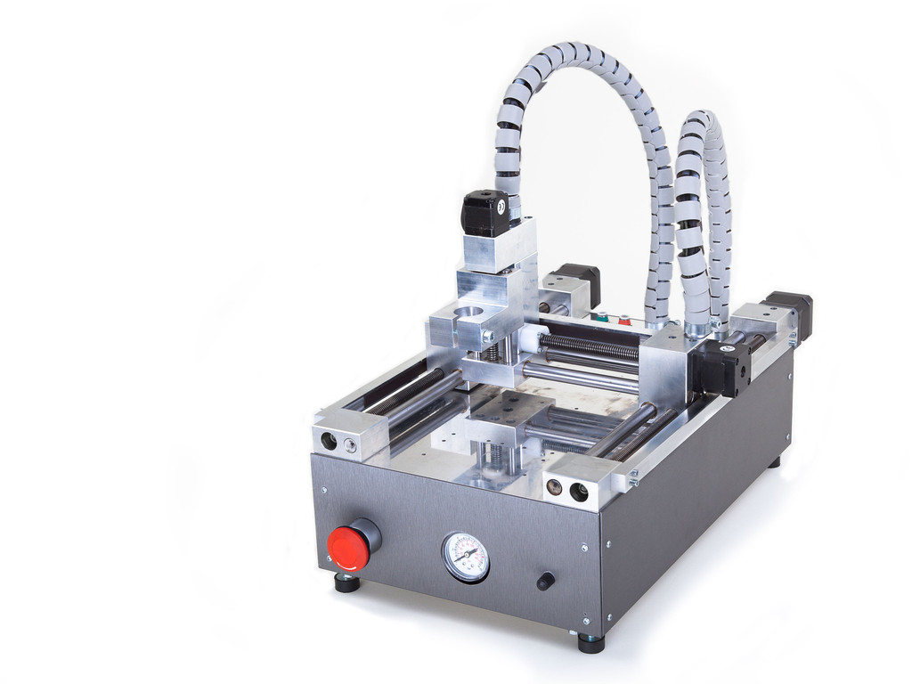
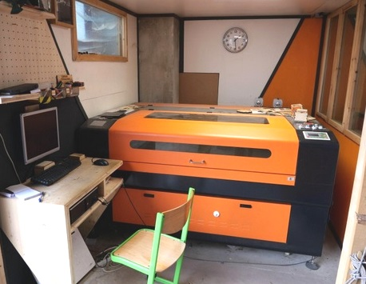
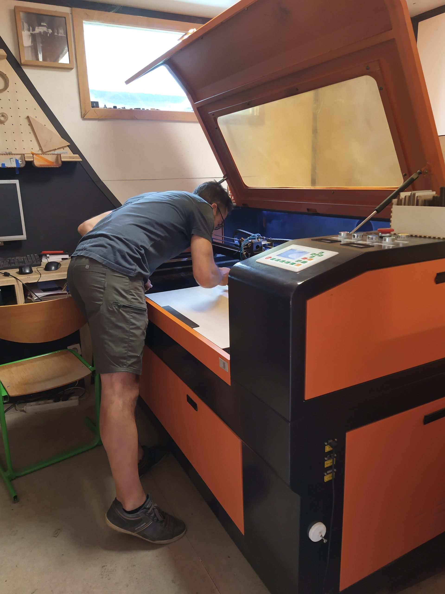
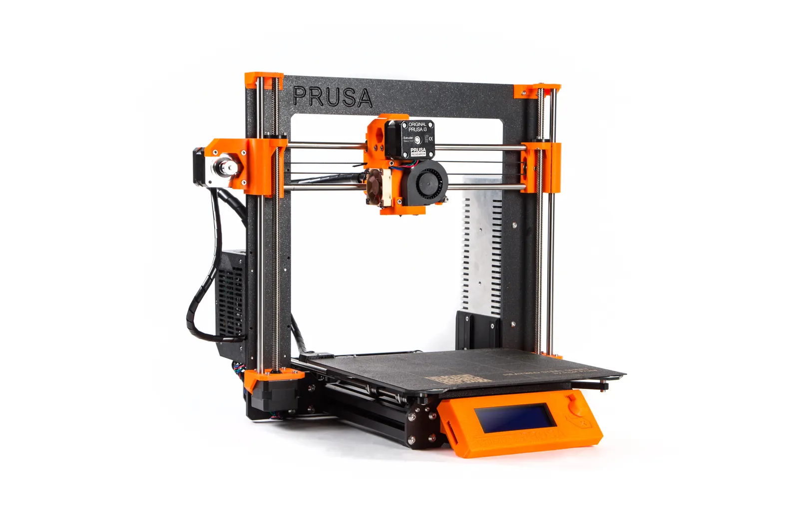

Surface : 50 m²

## Électronique

- Alimentation de laboratoire, oscilloscope, GBF
- Station à air chaud, fers à souder, binoculaire
- Prototypage PCB : Cirqoid

## Découpe et gravure laser  {#laser}

Surface utile : 120 cm × 90 cm — deux lasers 50 W et 150 W.

Matériaux compatibles : bois, carton, tissu, cuir, acrylique, verre (gravure), certains métaux (gravure).

**Initiation obligatoire** avant tout accès en autonomie. Un niveau minimum en manipulation de fichiers vectoriels (SVG, AI ou DXF) est requis.

**Groupe :** 1 à 3 personnes. **Tarif :** 30 €

## Impression 3D {#fdm}

- Prusa i3 MK3

### Initiation impression 3D (thématique)

Découvrir le fonctionnement d'une imprimante 3D, préparer un fichier et lancer une impression.
**Groupe :** 2 à 3 personnes. **Tarif :** 30 €

Réservation sur l'[Agenda](/agenda/).
