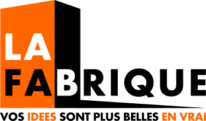
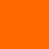
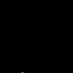
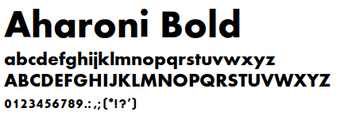

## ON PARLE DE NOUS

\[catlist name="Presse"\]

## LA FABRIQUE EN LOGO

### Le logotype

\> Le logo de La Fabrique se construit autour :

- d'une brique orange produisant une ombre

- d'une typo énonçant "LA FABRIQUE"

- souligné d'une typo énonçant le slogan "VOS IDÉES SONT PLUS BELLES EN VRAI"

### La couleur du logotype

\> Les références des couleurs du logo de La Fabrique

Version quadrichromie

Cyan : **60%**

Magenta : **100%**

Noir : **100%**

Version pantone

Pantone : **1505 C**

Pantone : **Noir neutre C**

### La typo du logotype

#### \> Aharoni Bold

### La signification du logotype

Dans ce logo à dominante orange, on reconnaît une brique qui souligne de son ombre le nom de l'association "La Fabrique". Cet élément unitaire de construction renforcé par le orange sécuritaire rappelle à la fois, la réalisation - objet principal de l'association - ainsi que l'aspect multi-disciplinaire des ateliers - chacun amène sa brique -.

## NOS COMMUNIQUES DE PRESSE
